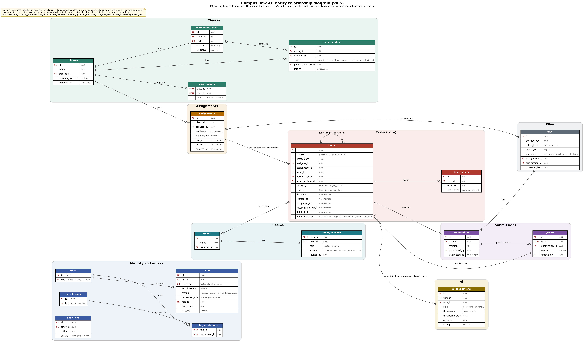

# CampusFlow AI: data model

Version 0.5, 24 Oct 2026. Approved design in plain language, **not** Drizzle code. Updated after the Opus review. `decisions.md` wins if anything here disagrees with it.

## What changed since v0.4

- **`users.username` is nullable** until the welcome screen (Google creates the user row first). App-owned user fields are Better Auth `additionalFields` with `input: false`.
- **`is_seed` only on `users`.** Everything a seed user owns is simulated.
- **Files have one parent:** `files.assignment_id` or `files.submission_id`. Tables `assignment_files` and `submission_files` are **removed**.
- **`assignments.closed_at` removed**; `closes_at` alone decides. "Close now" sets it to the current time.
- **`tasks.deleted_reason`** added (user_deleted, recipient_removed, assignment_cancelled).
- **Unique (assignment_id, assignee_id) only for top-level tasks** (partial index). Subtasks copy the parent's context, assignee, `assignment_id` and `team_id`.
- **Status CHECK tightened:** `completed_at` is set exactly when status = done.
- **`ai_suggestions`:** kind `estimate` removed; new `timeframe` (week, month); unique summary per user and timeframe.
- **`task_events.event_type`** gains `start_backfilled` (the "When did you start?" answer).
- **`audit_logs` and `task_events` are append-only** by database trigger.
- **Small additions:** `class_members.left_at` (for the left-class metric rule), `team_members.status` value `left` (members could leave but had no status for it), one-creator index on `team_members`, `files.sha256`.
- Rules 2, 3, 7, 9 and 10 updated (deletion, team deadlines, teams, left classes, roles).

(Earlier: v0.4 join requests, usernames, requested role, calculated lateness, assignment cancel, file purpose; v0.3 team invitations, ER diagram; v0.2 co-teachers, soft delete, `task_events`, `category_other`, `resubmission_until`, one grade per task.)

## Entity relationship diagram

`er-diagram.svg` (same content) stays sharp when zoomed. The diagram shows the main columns; this document lists them all.

### Relationships in words

- A **role** has many users and many role_permissions. A **permission** appears in many role_permissions.
- A **class** has many class_faculty rows (one owner, optional co-teachers), many class_members, many enrollment_codes and many assignments. An enrollment code can be the source of many class_members (join requests).
- An **assignment** has many attachment files (`files.assignment_id`) and becomes **one top-level task per recipient** (`tasks.assignment_id`).
- A **task** may have many subtasks (`tasks.parent_task_id`), many task_events, many submissions, at most one grade and many ai_suggestions.
- A **team** has many team_members and many tasks (`tasks.team_id`).
- A **submission** has many files (`files.submission_id`). A **grade** points to the submission version that was graded.
- **users** is referenced by the `created_by`, `uploaded_by`, `assignee_id`, `actor_id`, `submitted_by`, `graded_by`, `invited_by`, `added_by`, `approved_by`, `status_changed_by` and `user_id` columns (listed in the note on the diagram).

## Conventions

- Primary keys: `id` as UUID unless a table uses a composite key (noted). Better Auth is configured with `advanced.database.generateId: "uuid"` so its IDs are UUIDs too. **[Verify]** the option name in Slice 0.
- Timestamps: `timestamptz`, stored in UTC. Most tables have `created_at`; mutable ones also `updated_at`.
- Enums: Postgres enums (Drizzle `pgEnum`), defined once in `db/schema/enums.ts`.
- "Req" = required (NOT NULL). "Opt" = optional (nullable). Defaults are real database defaults, not only JavaScript defaults.
- `is_seed` exists only on `users`. Queries and the UI treat everything owned by a seed user as simulated.
- Computed values (overdue, late, active time, overall time, on-time, rates) are **not stored**; they are calculated in queries.
- Better Auth owns `session`, `account`, `verification` and the base `user` table. `account` holds the password hash and the Google link. Our code never writes those tables, with one exception: deactivation deletes the user's `session` rows (`permissions.md` §6 rule 9).

Total: **18 tables of our own** (including the extended `users`), plus Better Auth's.

---

## 1. Identity and access

### users (Better Auth `user` table, extended)

| Column | Type | Notes |
|---|---|---|
| id | uuid | Generated as UUID (see conventions) |
| name | text, req | From sign-up or Google |
| email | text, req, unique | |
| email_verified | boolean, req | Provided by Better Auth (Google sets true; email sign-ups stay false in the MVP). Shown on the approval page |
| image | text, opt | Google avatar |
| username | text, opt, unique | From the Better Auth **username plugin**: stored lower case (the plugin also keeps `display_username`). Null until the welcome screen; a user without one is sent to `/welcome`. 3 to 20 characters: letters, numbers, dot, underscore. Cannot be changed once set (`immutableUsername`) |
| display_username | text, opt | Added by the plugin: the username as typed |
| status | enum, req | pending, active, rejected, deactivated. Database default pending. `input: false` |
| requested_role | enum, opt | student or faculty, set by our welcome action; a hint only. `input: false` (written by our action, not by Better Auth's endpoint) |
| role_id | FK roles, opt | Null until approved. `input: false` |
| timezone | text, req | Default `Asia/Kolkata`. Changed only through our settings action. `input: false` |
| approved_by | FK users, opt | `input: false` |
| approved_at | timestamptz, opt | `input: false` |
| rejection_reason | text, opt | `input: false` |
| is_seed | boolean, req | Default false. `input: false` |
| created_at, updated_at | timestamptz | |

**[Verify]** in Slice 1: how the username plugin's columns and `additionalFields` are declared together with the Drizzle adapter, and that `input: false` also blocks `update-user` (the test in `permissions.md` §9 proves it either way).

### roles

| Column | Type | Notes |
|---|---|---|
| id | uuid | |
| key | text, req, unique | admin, faculty, student |
| name | text, req | Display name |
| description | text, opt | |
| is_system | boolean, req | True for the three roles (cannot be deleted) |
| created_at | timestamptz | |

### permissions

Seeded from `permission-keys.ts`; admins cannot create keys, only assign existing ones to eligible roles. Eligible and default roles live in code, not in this table.

| Column | Type | Notes |
|---|---|---|
| id | uuid | |
| key | text, req, unique | e.g. `class.create`, `assignment.manage`, `submission.grade` |
| module | text, req | Grouping for the Admin page |
| description | text, req | Shown on the Admin page |

### role_permissions

| Column | Type | Notes |
|---|---|---|
| role_id | FK roles | Composite PK with permission_id |
| permission_id | FK permissions | |
| created_at | timestamptz | |

### audit_logs (append-only)

| Column | Type | Notes |
|---|---|---|
| id | uuid | |
| actor_id | FK users, req | Who did it |
| action | text, req | e.g. `user.approved`, `role.changed`, `permission.granted`, `reset_link.created`, `class.ownership_transferred`, `submission_file.viewed` |
| target_type | text, req | user, role, class, team, file, etc. |
| target_id | text, opt | |
| details | jsonb, opt | Before and after values; `via: "admin"` for Admin access |
| created_at | timestamptz | |

A trigger rejects UPDATE and DELETE on this table.

---

## 2. Classes

### classes

| Column | Type | Notes |
|---|---|---|
| id | uuid | |
| name | text, req | |
| course_code | text, opt | |
| description | text, opt | |
| term | text, opt | e.g. "2026-27 Sem 7" |
| created_by | FK users, req | |
| requires_approval | boolean, req | Default true. When false, a valid code joins the student at once. Removed or declined students are always reviewed |
| archived_at | timestamptz, opt | Soft archive, never hard delete |
| created_at, updated_at | timestamptz | |

### class_faculty

| Column | Type | Notes |
|---|---|---|
| class_id | FK classes | Composite PK with user_id |
| user_id | FK users | Must be an active Faculty user (checked in code) |
| role | enum, req | owner, co_teacher |
| added_by | FK users | |
| created_at | timestamptz | |

Constraint: exactly one `owner` per class (partial unique index on class_id where role = owner). Ownership transfer swaps the roles in one transaction.

### class_members

| Column | Type | Notes |
|---|---|---|
| id | uuid | |
| class_id | FK classes, req | |
| student_id | FK users, req | |
| status | enum, req | requested, active, leave_requested, left, removed, rejected |
| joined_via_code_id | FK enrollment_codes, opt | |
| requested_at | timestamptz, opt | When the student entered the code |
| joined_at | timestamptz, opt | Set when approved (or at once when approval is off) |
| left_at | timestamptz, opt | Set when the status becomes left or removed. Used by the metric rule for left classes |
| leave_requested_at | timestamptz, opt | |
| leave_reason | text, opt | |
| status_changed_at | timestamptz, req | |
| status_changed_by | FK users, opt | Faculty who approved, declined or removed |

Constraint: unique (class_id, student_id). Entering a code again after `left` or `removed` sets the same row back to `requested` (and clears `left_at`); a `rejected` student cannot request again until the teacher reconsiders (rule 8). Students whose status is `requested` or `rejected` see no class content.

### enrollment_codes

| Column | Type | Notes |
|---|---|---|
| id | uuid | |
| class_id | FK classes, req | |
| code | text, req, unique | 8 characters, no look-alike characters, stored upper case |
| created_by | FK users, req | |
| expires_at | timestamptz, req | The join check compares with the current time |
| is_active | boolean, req | Faculty can deactivate manually |
| deactivated_at | timestamptz, opt | |
| created_at | timestamptz | |

---

## 3. Assignments

### assignments

| Column | Type | Notes |
|---|---|---|
| id | uuid | |
| class_id | FK classes, req | |
| created_by | FK users, req | Faculty |
| title | text, req | |
| description | text, opt | |
| audience | enum, req | all, selected (informational; the real recipients are the task rows) |
| max_marks | numeric, req | Positive. Locked once any grade exists (code) |
| due_at | timestamptz, req | Copied to each recipient task's `deadline` |
| closes_at | timestamptz, opt | After this time new submissions are refused (unless the task has a resubmission window). "Close now" sets it to the current time. Empty = never closes |
| deleted_at | timestamptz, opt | Cancelled; only allowed while there are no submissions. Its recipient tasks are soft-deleted with `deleted_reason = assignment_cancelled` |
| created_at, updated_at | timestamptz | |

Attachments are `files` rows with `assignment_id` set (section 7).

---

## 4. Tasks (the core)

### tasks

| Column | Type | Notes |
|---|---|---|
| id | uuid | |
| context | enum, req | personal, assignment, team |
| created_by | FK users, req | |
| assignee_id | FK users, opt | Required for personal and assignment. Optional for team (unassigned team task) |
| assignment_id | FK assignments, opt | Required when context = assignment (also on subtasks) |
| team_id | FK teams, opt | Required when context = team (also on subtasks) |
| parent_task_id | FK tasks, opt | Subtask link; one level only |
| title | text, req | |
| description | text, opt | |
| category | enum, req | assignment, study, project, reading, other |
| category_other | text, opt | Custom label. Required when category = other, otherwise null (CHECK) |
| priority | enum, req | low, medium, high. Default medium |
| status | enum, req | todo, in_progress, done. Default todo. UI label: "To Do" |
| source | enum, req | manual, ai_breakdown |
| ai_suggestion_id | FK ai_suggestions, opt | The suggestion that created this subtask (when source = ai_breakdown) |
| deadline | timestamptz, opt | Current deadline |
| original_deadline | timestamptz, opt | Set the first time a deadline is set |
| reschedule_count | int, req | Default 0. See rules |
| estimate_minutes | int, opt | |
| estimate_source | enum, opt | user, history, ai |
| resubmission_until | timestamptz, opt | Assignment tasks only. Faculty set it to allow another submission after the close time or after grading |
| started_at | timestamptz, opt | First time status became in_progress, or the "When did you start?" answer; never overwritten once set |
| completed_at | timestamptz, opt | |
| deleted_at | timestamptz, opt | Soft delete |
| deleted_reason | enum, opt | user_deleted, recipient_removed, assignment_cancelled. Required when `deleted_at` is set (CHECK) |
| created_at, updated_at | timestamptz | |

Not stored, calculated: overdue, active time, overall time, on-time, planned-for-week, "needs re-review" (a submission version newer than the graded one).

Enforced by the database (CHECK, index) or by code:
- context = personal: assignment_id and team_id null; assignee_id = created_by.
- context = assignment: assignment_id and assignee_id required; team_id null. **Partial unique index (assignment_id, assignee_id) WHERE parent_task_id IS NULL**, so a student never gets the same assignment twice and can still have subtasks.
- context = team: team_id required.
- `(status = 'done') = (completed_at IS NOT NULL)` (CHECK).
- category = other requires `category_other`; any other category requires it null (CHECK).
- `deleted_at` and `deleted_reason` are both set or both null (CHECK).
- A subtask's parent must be a top-level task; the subtask copies the parent's context, assignee, assignment_id and team_id (code).
- A parent cannot become done by hand while any subtask is not done, except with the explicit "complete all" choice; a first submission completes an assignment task and its open subtasks (code).
- `started_at` must not be later than `completed_at` (CHECK).

### task_events (append-only)

| Column | Type | Notes |
|---|---|---|
| id | uuid | |
| task_id | FK tasks, req | |
| actor_id | FK users, req | |
| event_type | enum, req | created, status_changed, deadline_changed, reopened, deleted, restored, resubmission_granted, reassigned, start_backfilled |
| from_value | text, opt | |
| to_value | text, opt | |
| created_at | timestamptz | When it happened |

A trigger rejects UPDATE and DELETE on this table.

### Rules agreed (these affect queries)

1. **Subtasks are not counted** in any metric. Only top-level tasks count.
2. **Deletion:** soft delete with a reason. Students cannot delete assignment tasks. Faculty removing a recipient sets `recipient_removed`; cancelling an assignment sets `assignment_cancelled`; those two are **always excluded** from metrics. A `user_deleted` task still counts if it was already completed, or already past its deadline, when deleted; otherwise it is excluded. Deleting therefore cannot be used to change history.
3. **Deadline edits on personal and team tasks:** on-time uses the current deadline. `reschedule_count` increases each time the **assignee** moves the deadline later. `original_deadline` keeps the first deadline. Only the assignee may move a team task's deadline.
4. **Faculty changing an assignment's due date** updates every recipient task's `deadline` and logs `deadline_changed`, but does **not** increase `reschedule_count`.
5. **Reopening:** allowed for personal and team tasks (clears `completed_at`, keeps `started_at`, logs `reopened`). Not allowed for assignment tasks; faculty use `resubmission_until`, so the task stays done and the first submission time still decides on-time.
6. **One grade per task.** Editing replaces the previous grade.
7. **Team membership (invite and accept):** the creator's row is `active` from creation. The creator invites an active **Student**, found by exact email or exact username; the reply is the same whether or not the user exists. The row starts as `invited`; the invitee accepts (`active`, `joined_at` set) or declines (`declined`). Only `active` members see the team and its tasks and can create or be assigned team tasks. Re-inviting someone who declined or was removed resets their row to `invited`. Pending invitations appear in the app (no email). The creator can remove members, members can leave, and the creator cannot be removed (Admin can transfer the creator role). Tasks assigned to a removed member stay assigned to them for history, show "former member", and any active member can reassign them (logged as `reassigned`). Only the assignee changes a team task's status.
8. **Joining a class (request and approve):** a valid code creates a request (`requested`), or an active membership when `requires_approval` is off. The teacher approves (`active`) or declines (`rejected`). A declined student cannot request again by themselves; the teacher can reconsider, which sets the row back to `requested`. A student who left or was removed also goes through `requested`.
9. **Left or removed students:** their assignment tasks from that class stay for history and are hidden from active lists. In metrics they count only if their deadline was before `class_members.left_at`.
10. **Role changes** are refused while the user has class or team relationships (`permissions.md` §6 rule 8), so no stale `class_faculty`, `class_members` or `team_members` rows can exist for the wrong role.

---

## 5. Submissions

### submissions (one row per version)

| Column | Type | Notes |
|---|---|---|
| id | uuid | |
| task_id | FK tasks, req | The student's top-level assignment task |
| version | int, req | 1, 2, 3 ... Unique (task_id, version) |
| text_body | text, opt | Length limit in `src/config/` |
| link_url | text, opt | http or https only |
| submitted_by | FK users, req | |
| submitted_at | timestamptz, req | Late or on time is calculated from this and the current deadline; never stored |

At least one of text_body, link_url or an attached file is required (code). Files are `files` rows with `submission_id` set.

### grades

| Column | Type | Notes |
|---|---|---|
| id | uuid | |
| task_id | FK tasks, req, unique | One grade per student task |
| submission_id | FK submissions, req | The version that was graded |
| marks | numeric, req | Between 0 and the assignment's max_marks (code) |
| comment | text, opt | |
| graded_by | FK users, req | Class Faculty (never Admin) |
| graded_at | timestamptz, req | |
| updated_at | timestamptz | |

---

## 6. Teams

### teams

| Column | Type | Notes |
|---|---|---|
| id | uuid | |
| name | text, req | |
| description | text, opt | |
| created_by | FK users, req | The current creator (changes on transfer) |
| archived_at | timestamptz, opt | |
| created_at, updated_at | timestamptz | |

### team_members

| Column | Type | Notes |
|---|---|---|
| team_id | FK teams | Composite PK with user_id |
| user_id | FK users | |
| role | enum, req | creator, member |
| status | enum, req | invited, active, declined, removed, left |
| invited_by | FK users, req | |
| invited_at | timestamptz, req | |
| responded_at | timestamptz, opt | When the invitee accepted or declined |
| joined_at | timestamptz, opt | Set on accept (for the creator: at team creation) |
| removed_at | timestamptz, opt | Set when removed or left; their old team tasks stay |

Constraint: exactly one `creator` per team (partial unique index).

---

## 7. Files

### files

| Column | Type | Notes |
|---|---|---|
| id | uuid | |
| storage_provider | enum, req | local (only value in the MVP; kept so another provider can be added) |
| storage_key | text, req | Random ID; never the user's file name |
| original_name | text, req | For display; encoded when sent in a header |
| mime_type | text, req | Decided from the content (PDF, JPEG, PNG) |
| size_bytes | bigint, req | |
| sha256 | text, req | Checksum, used by the upload test and to detect corruption |
| uploaded_by | FK users, req | |
| purpose | enum, req | assignment_attachment, submission |
| assignment_id | FK assignments, opt | Set when an attachment is attached |
| submission_id | FK submissions, opt | Set when a submission file is attached |
| attached_at | timestamptz, opt | Set when the file is attached. Unattached files older than 24 hours are removed by `npm run files:cleanup` |
| created_at | timestamptz | |
| deleted_at | timestamptz, opt | Faculty removed an attachment (only before the first submission) |

CHECKs: at most one of `assignment_id` and `submission_id` is set; `assignment_id` only when purpose = assignment_attachment; `submission_id` only when purpose = submission; `attached_at` is set exactly when one of them is set.

The size cap (`MAX_FILE_SIZE_BYTES`, 10 MB) and the count cap (20) are settings in `src/config/`, not columns. Access is decided through the parent (assignment or submission); the file row has no permissions of its own.

---

## 8. AI

### ai_suggestions

| Column | Type | Notes |
|---|---|---|
| id | uuid | |
| user_id | FK users, req | |
| task_id | FK tasks, opt | For breakdowns |
| kind | enum, req | breakdown, summary |
| timeframe | enum, opt | week, month. Required for summaries |
| timeframe_start | date, opt | First day of the week or month. Required for summaries |
| model | text, req | e.g. llama3.2:3b |
| prompt_version | text, req | |
| input_snapshot | jsonb, req | What was sent (title, description as cut for the prompt, existing step titles, today, deadline, time zone). For a breakdown, once the answer is valid, also `suggested`: the list the student was shown (title, minutes, due date), which "accepted" and "edited" are decided against |
| output_raw | text, opt | What came back |
| output_valid | boolean, req | Did it pass validation |
| latency_ms | int, opt | |
| items_suggested | int, opt | Subtasks or suggestions produced |
| items_kept | int, opt | Subtasks the student kept |
| outcome | enum, req | pending, accepted, edited, discarded, failed |
| rating | smallint, opt | 1 to 5 from the student |
| feedback_text | text, opt | |
| created_at | timestamptz | |
| resolved_at | timestamptz, opt | |

Constraint: unique (user_id, kind, timeframe, timeframe_start) where kind = summary and the timeframe has ended, so a closed timeframe has one stored summary that is reused. (Simplest implementation: insert summaries only for ended timeframes and keep the current timeframe's summary unsaved, or use a partial unique index on `kind = 'summary'` and update the row while the timeframe is current. Decide in Slice 9.)

Training or fine-tuning on this data is out of scope.

---

## Not stored on purpose

- **Growth Tracker numbers:** computed from `tasks`, `task_events`, `submissions` and `class_members`. Caching only if measured slow.
- **AI evaluation set:** JSON files in `eval/`, not in the database.
- **Rate-limit counters:** in memory (one process on one laptop).
- **Out of scope tables:** notifications, messages, comments, notes, milestones, calendar sync, workflows, team join codes.

## Indexes (initial)

`tasks (assignee_id, deadline)`, `tasks (assignment_id)`, `tasks (team_id)`, `tasks (parent_task_id)`, `task_events (task_id, created_at)`, `submissions (task_id, version)`, `class_members (class_id, status)`, `team_members (user_id, status)`, `files (assignment_id)`, `files (submission_id)`, `ai_suggestions (user_id, kind, created_at)`. Add others only when a query is measured slow.

## Later (not in the MVP)

Team join codes (a `team_join_codes` table), calendar sync, CSV bulk import, workflow locking, per-user custom permissions, per-student deadline extensions, team assignments, milestones, other storage providers.
